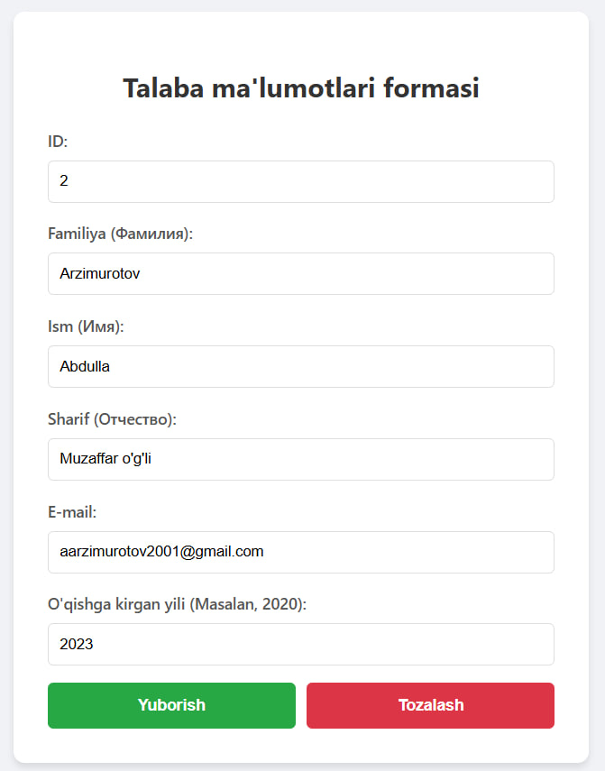
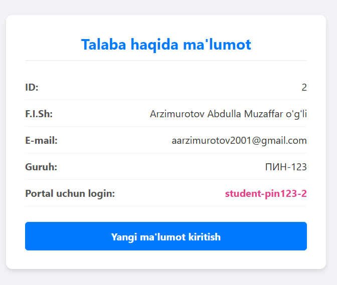

## Цель работы
Изучить основы работы фреймворка Spring Boot, настроить маршрутизацию и реализовать передачу и обработку данных с HTML-формы с использованием шаблонизатора Thymeleaf.

## Архитектура проекта
- **Стек:** Spring Boot 3, Maven, Java 17, Thymeleaf
- **Основные слои:**
    - Controller (`MainController` — перехват и обработка GET и POST запросов)
    - Model (`Student` — POJO-класс, содержащий данные и бизнес-логику генерации логина и названия группы)
    - View (`main-form.html`, `result.html` — пользовательский интерфейс)
- **Ключевые аннотации:** `@SpringBootApplication`, `@Controller`, `@GetMapping`, `@PostMapping`, `@ModelAttribute`

## Алгоритм работы
1. При GET-запросе на `/form` контроллер инициализирует пустой объект `Student` и передает его в шаблон `main-form.html`.
2. Пользователь вводит данные (ID, ФИО, email, год поступления) на веб-странице и отправляет форму.
3. Инициируется POST-запрос. Данные формы перехватываются аннотацией `@ModelAttribute` и автоматически привязываются к соответствующим полям объекта `Student`.
4. В процессе привязки данных класс `Student` автоматически формирует название группы (ПИН-1 + год) и логин для портала.
5. Контроллер передает заполненный объект `Student` в шаблон `result.html`, где Thymeleaf динамически рендерит итоговую карточку с данными.

## Скриншот работы приложения

**Форма заполнения данных:**

**Результат работы приложения:**

