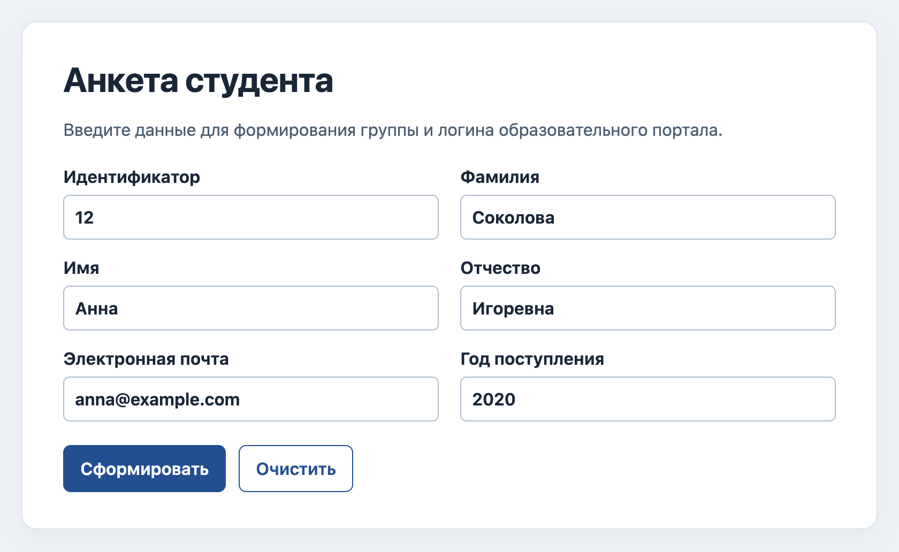
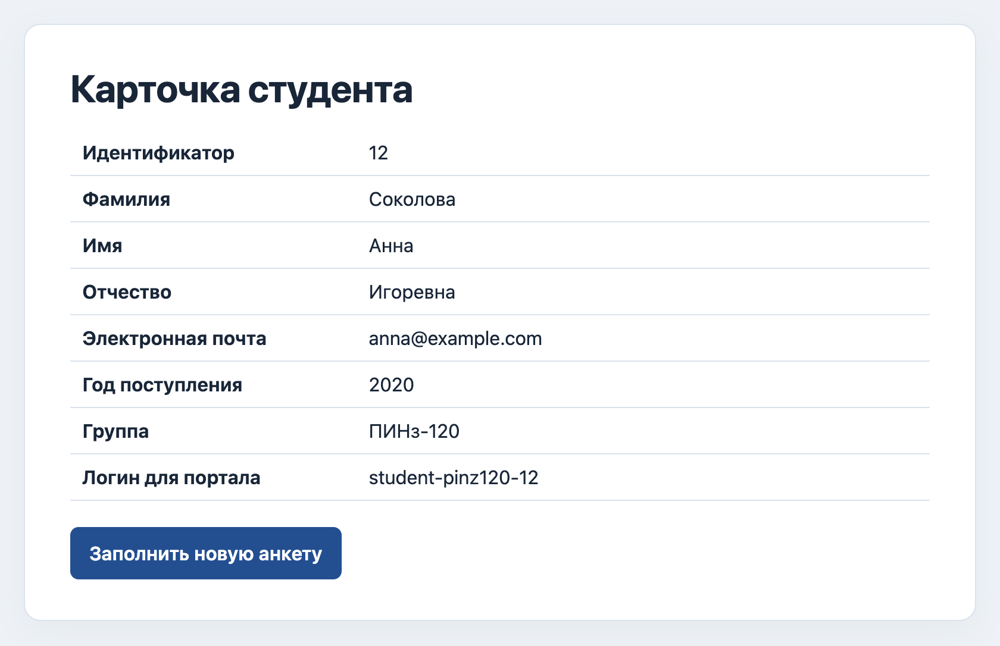

# Лабораторная работа № 1. Введение в Spring Boot

## Цель работы

Реализовать HTML-форму для ввода данных студента и сформировать карточку с названием группы и логином образовательного портала.

## Архитектура проекта

Стек включает Java 17, Spring Boot 3.5.16, Maven Wrapper и Spring MVC, Thymeleaf, Jakarta Validation.

- `MainController` открывает форму и передаёт проверенные данные в шаблон результата.
- `Student` хранит поля анкеты и вычисляет группу и логин.
- `main-form.html` и `result.html` отвечают за ввод и отображение.
- Аннотации `@SpringBootApplication`, `@Controller`, `@GetMapping`, `@PostMapping`, `@ModelAttribute`, `@Valid`.

## Алгоритм работы

1. Откройте форму и введите идентификатор, фамилию, имя, отчество, почту и год поступления.
2. После отправки сервер проверяет данные. При ошибке форма снова отображается с сообщением.
3. Для идентификатора `12` и года `2020` результат содержит группу `ПИНз-120` и логин `student-pinz120-12`.

## Запуск в IntelliJ IDEA

1. Откройте папку с файлом `pom.xml` в IntelliJ IDEA и дождитесь импорта Maven.
2. В **File → Project Structure → Project SDK** выберите JDK 17, если среда ещё не выбрала его.
3. Выберите конфигурацию **Лабораторная 1** и нажмите **Run**. Откройте [страницу приложения](http://127.0.0.1:8081/form).

Для проверки проекта из терминала выполните `./mvnw clean verify`.

## Скриншоты работы приложения

**Заполненная анкета**

**Результат формирования группы и логина**

